# Gallery recipes

Each figure in the README's gallery, drawn from the package's own data by
JBrowseMSA's SVG export and by ggmsaview.

- Each recipe runs as written after

  ```r
  library(ggmsaview)
  e <- function(f) system.file("extdata", f, package = "ggmsaview")
  ```

- `autoplot(w)` draws the right-hand figure with ggplot2, and
  `msaview_save(w, "figure.svg")` the left-hand one, through
  react-msaview-cli, which needs Node.
- `scripts/gallery.R` draws both and writes this page, so edit an example
  there.

<a id="insulin_tree"></a>

## Preproinsulin across nine vertebrates, beside its tree

<table>
<tr><td width="50%">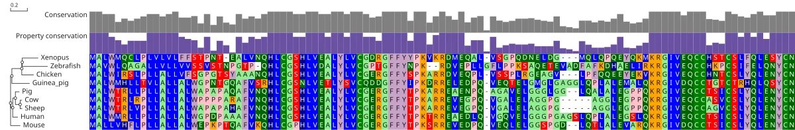</td><td width="50%">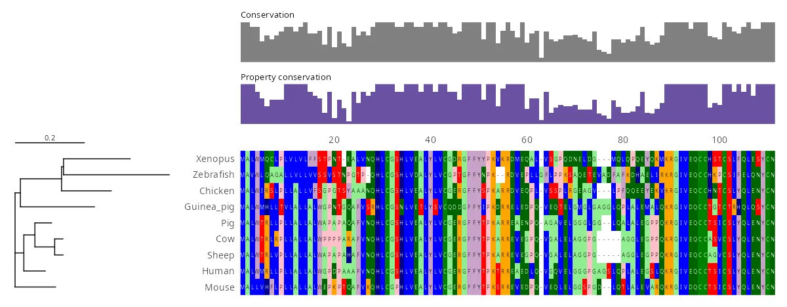</td></tr>
</table>

The B and A chains of mature insulin stay conserved under the conservation bars, while the C-peptide between them varies.

```r
w <- msaview(msa = e("insulin.aln"), tree = e("insulin.nh"))
autoplot(w)
msaview_save(w, "figure.svg")
```

<a id="insulin_diff"></a>

## The same alignment drawn as its differences from human

<table>
<tr><td width="50%">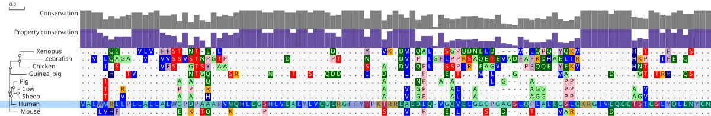</td><td width="50%">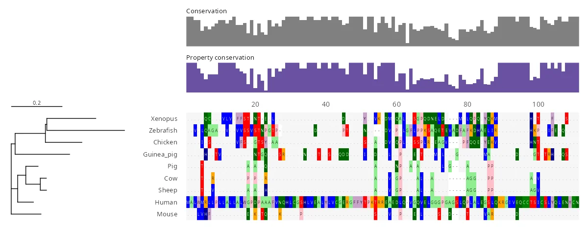</td></tr>
</table>

Every residue matching the human row prints as a dot, so the substitutions stand out in the C-peptide and the signal peptide.

```r
w <- msaview(msa = e("insulin.aln"), tree = e("insulin.nh"),
  relative_to = "Human")
autoplot(w)
msaview_save(w, "figure.svg")
```

<a id="insulin_clades"></a>

## Clade brackets over the insulin tree

<table>
<tr><td width="50%">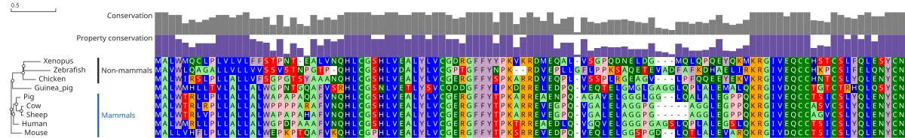</td><td width="50%">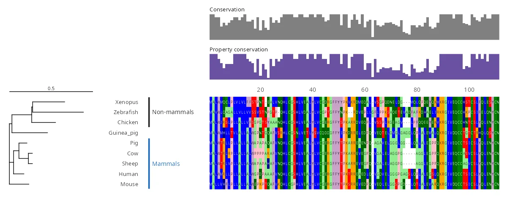</td></tr>
</table>

A bracket names the five mammals and another the three non-mammals, each in the gutter beside the tree.

```r
w <- msaview(msa = e("insulin.aln"), tree = e("insulin.nh")) +
  geom_msa_clade(range = c("Pig", "Mouse"), tips = 5, mark = "bracket",
    label = "Mammals", color = "#1565c0") +
  geom_msa_clade(range = c("Xenopus", "Chicken"), tips = 3, mark = "bracket",
    label = "Non-mammals")
autoplot(w)
msaview_save(w, "figure.svg")
```

<a id="kinase_domains"></a>

## Ten Src-family kinases with their InterPro domains

<table>
<tr><td width="50%">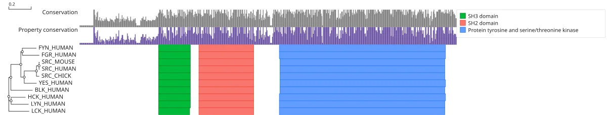</td><td width="50%">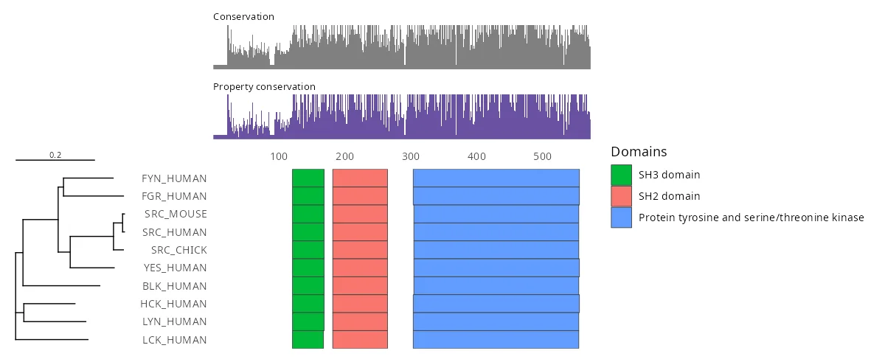</td></tr>
</table>

The SH3, SH2 and kinase domains line up in every member, the unique N-terminal region before them varying in length.

```r
w <- msaview(msa = e("kinase.aln"), tree = e("kinase.nh"),
  gff = e("kinase-domains.gff"), col_width = 1.5)
autoplot(w)
msaview_save(w, "figure.svg")
```

<a id="trna_structure"></a>

## tRNA with its consensus secondary structure

<table>
<tr><td width="50%">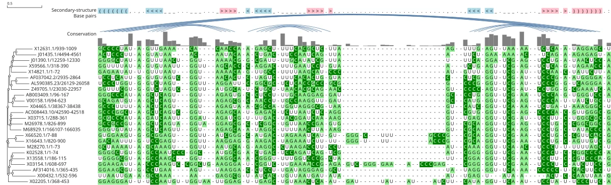</td><td width="50%">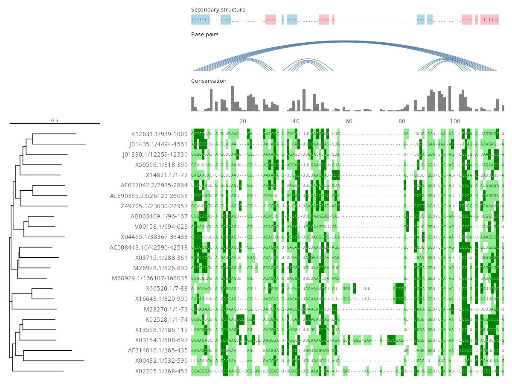</td></tr>
</table>

The four stems of the cloverleaf draw as base-pair arcs over the dot-bracket row, above conservation.

```r
w <- msaview(msa = e("trna.stock"))
autoplot(w)
msaview_save(w, "figure.svg")
```

<a id="gene_cluster"></a>

## A gene cluster across six genomes, with each genome's clade

<table>
<tr><td width="50%">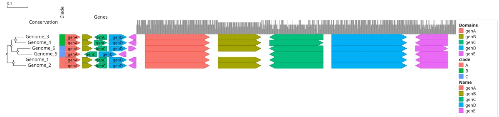</td><td width="50%">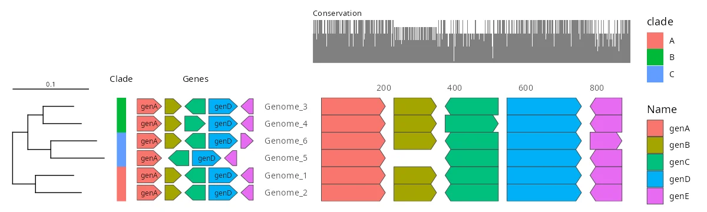</td></tr>
</table>

Each genome's genes as arrows in its own coordinates, genC reversed in every one and genB missing from Genome_5, beside a strip of its clade.

```r
clades <- data.frame(name = paste0("Genome_", 1:6),
  clade = c("A", "A", "B", "B", "C", "C"))
w <- msaview(msa = e("gene-cluster.stock"), gff = e("gene-cluster.gff"),
  col_width = 1) +
  geom_msa_rowdata(clades) +
  geom_msa_strip("clade", header = "Clade") +
  geom_msa_features(x = "position", color = "Name", label = "Name",
    header = "Genes")
autoplot(w)
msaview_save(w, "figure.svg")
```

